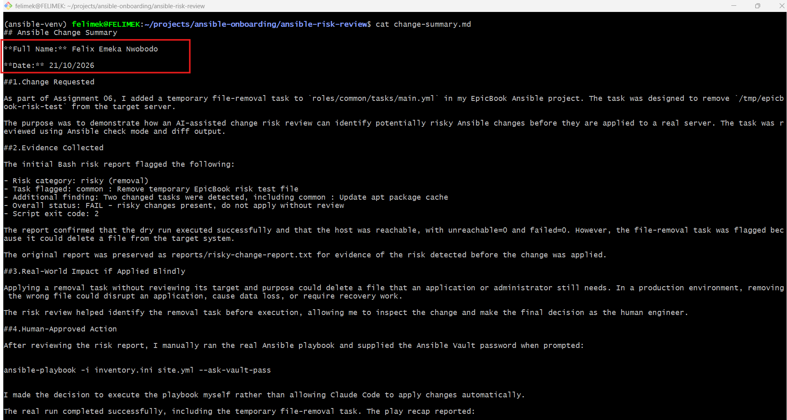

# Assignment 6 — AI-Assisted Ansible Change Risk Review

Part of the DevOps Micro Internship (DMI) with Agentic AI

---

## Purpose

In this assignment, you will build an AI-assisted Ansible risk-review workflow using `ansible-playbook --check --diff`, Bash scripting, and Claude Code.

You will review possible server changes before applying them, classify risky tasks, and keep the final apply decision under human control.

---

# Task 1 — Confirm EpicBook Connectivity and Create the Workspace

## Goal

Confirm that your previous EpicBook Ansible project is working before creating the risk-review automation.

### Evidence

#### Screenshot 1 — Output of `ansible web -i inventory.ini -m ping`

#### Screenshot 2 — Output of `ansible-playbook -i inventory.ini site.yml --syntax-check`

#### Screenshot 3 — Output of `pwd` and `find . -maxdepth 4 -type d | sort`

### Notes

Answer the following in your own words:

**1. What proves that Ansible can reach your EpicBook VM?**

A successful Ansible ping test that returns "ping": "pong" proves that Ansible can connect to the EpicBook VM and execute a basic module. It confirms that SSH connectivity, authentication, and Python availability are working correctly

**2. Why should you confirm playbook syntax before building a risk-review script?**

Confirming playbook syntax helps identify YAML formatting errors, incorrect indentation, and other playbook structure problems early. This ensures the playbook is valid before building a risk-review script, allowing the script to focus on identifying deployment risks rather than reporting errors caused by invalid syntax

# Task 2 — Create Project Context and Safety Rules in CLAUDE.md

## Goal

Create a `CLAUDE.md` file that tells Claude Code how this project must behave.

### Evidence

#### Screenshot 4 — `CLAUDE.md` open in VS Code or terminal showing the safety rules

### Notes

Answer the following in your own words:

**1. Why should Claude Code have project-specific safety rules?**

Project-specific safety rules help Claude Code understand the project's requirements, boundaries, and security practices. They prevent it from making unauthorized changes, exposing sensitive information, or performing risky actions that could damage the infrastructure

**2. Why should the human run the real Ansible playbook manually?**

The human should run the real Ansible playbook manually to review the proposed changes and confirm that it is safe to proceed. This keeps the human in control of the deployment and reduces the risk of unintended changes, service interruptions, or unexpected costs.

**3. Which rule prevents Claude Code from applying changes automatically?**

The rule that requires human approval before executing the real Ansible playbook prevents Claude Code from applying changes automatically. Claude Code can review the configuration and recommend actions, but the human must authorize and run the actual deployment.

# Task 3 — Ask Claude Code to Plan the Risk Review

## Goal

Use Claude Code to produce a read-only plan before writing the Bash script.

### Evidence

#### Screenshot 5 — Claude Code showing the four-category risk-classification plan

### Notes

Answer the following in your own words:

**1. Which part of this task represents the Gather phase?**

The Gather phase involves collecting information from the Ansible playbook using --check --diff to identify proposed changes without applying them. The output is used to prepare a report of tasks that may affect the system.

**2. Which part represents the Analyze phase?**

The Analyze phase involves reviewing the proposed changes and classifying them into four risk categories: service restarts or handlers, firewall changes, user or sudo changes, and package or file removal. This helps identify potential impacts and determine which changes require human review

**3. How did you verify Claude Code did not create or edit files?**

I checked Claude Code's response and confirmed that it only proposed a plan and asked for permission before creating the script. I also verified that no files were created or edited by checking the project's Git status and working directory

# Task 4 — Build the Ansible Risk Review Script

## Goal

Create a Bash script that runs an Ansible dry run and classifies risky changes.

### Evidence

#### Screenshot 6 — Top section of `ansible-check-review.sh` showing `full_name`, `playbook_path`, `inventory_path`, and the `checks` array

#### Screenshot 7 — Middle section showing `extract_changed_tasks` and `check_tasks_matching_pattern`

#### Screenshot 8 — Bottom section showing the loop, summary, and exit behavior

#### Screenshot 9 — Output of `bash -n ansible-check-review.sh` and `ls -l ansible-check-review.sh`

### Notes

Answer the following in your own words:

**1. What is stored in the `changed_tasks` array?**

The changed_tasks array stores the names or details of Ansible tasks that are expected to make changes to the system during the playbook run. It helps the script identify which tasks need further risk assessment.

**2. Which function finds changed tasks from the Ansible output?**

The function responsible for parsing the Ansible output and identifying tasks that report changes is the task-detection or changed-task extraction function. It reads the output and adds the detected changed tasks to the changed_tasks array.

**3. Why does the script use `--check --diff`?**

The script uses --check --diff to preview the changes Ansible would make without intentionally applying them. Check mode simulates the playbook execution where supported, while diff mode shows the differences Ansible expects to make. This helps identify potential risks before deployment

**4. Why does the script use different exit codes for healthy, warning, and failed results?**

Different exit codes allow users and automation tools to distinguish between a successful review with no flagged risks, a review that identifies changes requiring human attention, and a failed review caused by an error. This makes the script easier to troubleshoot and helps prevent risky changes from being overlooked.

# Task 5 — Run the Baseline Dry-Run Review

## Goal

Run the script against your current EpicBook playbook and confirm the baseline risk status.

### Evidence

#### Screenshot 10 — Output of `./ansible-check-review.sh`

#### Screenshot 11 — Output of `echo "Captured Exit Code: $script_exit_code"` and `cat reports/ansible-risk-report.txt`

### Notes

Answer the following in your own words:

**1. What was the overall status of your baseline run?**

The baseline run completed with a warning. The Ansible dry run executed successfully, and there were no unreachable hosts or failed tasks. However, one task was detected as having a potential change, so the script recommended reviewing it before applying any changes.

**2. Did any tasks report `changed`?**

Yes. One task, “Update apt package cache” under the common role, was reported as a potential change. This means Ansible detected that the package cache update would make a change during the dry run.

**3. Were any changed tasks flagged as risky?**

The script flagged the detected change for review, but it did not identify any high-risk operations. No service restarts, firewall changes, user or sudo modifications, or removal tasks were detected. The package cache update was the only item requiring review

**4. What does the script exit code mean?**

The script returned exit code 1, indicating that the review finished with a warning because a potential change was detected. It did not mean the playbook failed. The report showed zero failures and zero unreachable hosts, but the warning indicated that I should review the proposed change before applying it.

# Task 6 — Create and Run the Claude Code Skill

## Goal

Turn the Bash script into a reusable Claude Code skill called `/ansible-risk-review`.

### Evidence

#### Screenshot 12 — `SKILL.md` showing the frontmatter, allowed tools, and safety rules

#### Screenshot 13 — Claude Code output after running `/ansible-risk-review`

### Notes

Answer the following in your own words:

**1. Why does this skill allow `Bash`, `Read`, and `Grep`?**

The skill allows Bash to execute the read-only Ansible dry-run script, Read to inspect the generated reports and raw output, and Grep to search for important results such as changed tasks, failures, and the Ansible recap. These tools provide the evidence needed to assess the playbook.

**2. Why does this skill not allow file editing?**

The skill does not allow file editing because its purpose is to review changes and identify risks, not modify the playbook or configuration files. This separation helps prevent accidental changes and ensures that a human reviews and approves any modifications before they are applied.

**3. What part is handled by Bash?**

Bash runs the risk-review script, executes the Ansible playbook in check mode with diff enabled, captures the output, checks for potential risks, and generates the risk report. It performs the predefined checks consistently and records the results

**4. What part is handled by Claude Code?**

Claude Code reads the instructions, examines the generated report and raw Ansible output, interprets the findings, identifies potentially risky tasks, explains their possible impact, and recommends whether human review is needed before applying changes.

**5. Why is this better than asking Claude Code if the playbook is safe without giving it evidence?**

This approach is better because Claude Code bases its assessment on actual Ansible output rather than assumptions. The dry run provides evidence about predicted changes, failed tasks, and unreachable hosts. Combining automated checks with Claude Code's analysis makes the review more consistent, transparent, and reliable while keeping the final decision under human control.

# Task 7 — Introduce a Controlled Risky Change and Let the Skill Catch It

## Goal

Add a small controlled risky change in your lab playbook and confirm the script and Claude Code catch it before applying.

### Evidence

#### Screenshot 14 — The added risky task inside the role file

#### Screenshot 15 — Output of `./ansible-check-review.sh`

#### Screenshot 16 — Claude Code `/ansible-risk-review` output showing the risky finding

#### Screenshot 17 — Output of `cat reports/risky-change-report.txt`

### Notes

Answer the following in your own words:

**1. Which risk category did the added task fall into?**

The added task fell into the file modification category because it was designed to create a file at /tmp/epicbook-risk-test on the managed server. It represents a change to the server's filesystem

**2. What evidence proves the task would change something?**

The Bash report identified two changed tasks, including common : Remove temporary EpicBook risk test file. The report marked two tasks as changes and flagged the removal task as risky. The Ansible dry-run output and its predicted change status provide evidence that the playbook would modify something.

**3. Did Claude Code apply the playbook?**

No, Claude Code did not apply the playbook. It only ran the Ansible dry run using check mode and analyzed the report. No actual changes were applied by the risk-review process.

**4. Why is it important that Claude Code only analyzed the risk?**

It is important because the purpose of the skill is to identify possible risks before changes are made. By only analyzing the results, Claude Code avoids making unauthorized changes and allows a human to review the evidence and approve or reject the proposed action.

**5. Which phase of the Agentic Loop is represented by the Bash report?**

The Bash report represents the Analyze phase of the Agentic Loop. It provides evidence about predicted changes and potential risks, which Claude Code interprets before a human decides whether to take action

# Task 8 — Apply as the Human, Verify, and Write the Change Summary

## Goal

Review the risky-change report, apply the playbook manually as the human operator, and verify the result.

### Evidence

#### Screenshot 18 — Output of the real playbook run showing the final recap with `failed=0`

#### Screenshot 19 — Output of `ansible web -i inventory.ini -m ping`

#### Screenshot 20 — Second `/ansible-risk-review` output after applying the change

#### Screenshot 21 — Output of `ls -lah reports`

#### Screenshot 22 — `change-summary.md` showing all required sections and your Full Name

### Notes

Answer the following in your own words:

**1. What command did you run to apply the change for real?**

I ran the following command to apply the Ansible playbook to my EpicBook VM:

ansible-playbook -i inventory.ini site.yml --ask-vault-pass

**2. Who made the final decision to apply the playbook?**

I made the final decision as the human engineer after reviewing the risk report generated by the Bash script and analyzed with Claude Code.

**3. What evidence proves the VM is still reachable?**

The Ansible ping command succeeded and returned pong, confirming that the VM was reachable:

ansible web -i inventory.ini -m ping --ask-vault-pass

The output showed epicbook | SUCCESS with "ping": "pong". The real playbook run also reported unreachable=0 and failed=0.

**4. Why should the risk review be run again after applying?**

The risk review should be run again to confirm that the changes have been applied successfully and that no unexpected changes remain. In my final report, the playbook showed changed=0, unreachable=0, and failed=0, with an overall status of HEALTHY. This provided evidence that the server was in the expected state.

**5. What could go wrong if an AI agent applied Ansible changes automatically?**

An AI agent could apply an incorrect or risky change without understanding its full impact. For example, it could remove an important file, disrupt a running service, or cause application downtime. Keeping the final decision with a human engineer allows the changes to be reviewed, approved, and verified before and after execution.

# LinkedIn Post Required

## Evidence

#### LinkedIn Post URL

Paste your LinkedIn post URL here:

https://www.linkedin.com/posts/felix-nwobodo-2a191856_dmibypravinmishra-ansible-agenticai-ugcPost-7519014207829405697-UZPS/?utm_source=share&utm_medium=member_desktop&rcm=ACoAAAvh1JkBJ6D4mRJp1t4mfqeNh2YQjVD8ZhE

#### Screenshot — Published LinkedIn post

# Required Files

Confirm that the following files are included in your GitHub repository or assignment folder:

- [ ] `CLAUDE.md`
- [ ] `ansible-check-review.sh`
- [ ] `.claude/skills/ansible-risk-review/SKILL.md`
- [ ] `reports/risky-change-report.txt`
- [ ] `reports/post-apply-report.txt`
- [ ] `change-summary.md`

---

# Submission Instructions

- Add all required screenshots in your submission.
- Full Name must be visible in required screenshots and reports.
- All required notes must be answered clearly.
- Do not expose SSH private keys, passwords, cloud credentials, database credentials, or secret environment variables.
- Add your GitHub repository or folder URL inside this document.

---

# Completion Checklist

- [ ] Task 1: EpicBook connectivity confirmed and workspace created
- [ ] Task 2: `CLAUDE.md` created with safety rules
- [ ] Task 3: Claude Code produced a read-only risk-review plan
- [ ] Task 4: `ansible-check-review.sh` created and syntax checked
- [ ] Task 5: Baseline dry-run review completed
- [ ] Task 6: Claude Code `/ansible-risk-review` skill created and tested
- [ ] Task 7: Controlled risky change introduced and detected
- [ ] Task 8: Human applied the change and verified the result
- [ ] Risky-change report saved
- [ ] Post-apply report saved
- [ ] Change summary completed
- [ ] All screenshots added
- [ ] All notes answered
- [ ] LinkedIn post published
- [ ] LinkedIn post URL added
- [ ] No sensitive information exposed

---

## About DMI & CloudAdvisory

DevOps Micro Internship (DMI) is a project-based DevOps program run by Pravin Mishra and The CloudAdvisory, focused on real-world execution, systems thinking, and career readiness.

It helps learners build strong DevOps foundations with hands-on experience.

---

## Resources

- DMI Official Website: [https://dmi.pravinmishra.com?utm_source=github&utm_medium=readme](https://dmi.pravinmishra.com?utm_source=github&utm_medium=readme)
- University: [https://university.pravinmishra.com?utm_source=github&utm_medium=readme](https://university.pravinmishra.com?utm_source=github&utm_medium=readme)
- Discord Community: [https://discord.pravinmishra.com?utm_source=github&utm_medium=readme](https://discord.pravinmishra.com?utm_source=github&utm_medium=readme)
- Blog: [https://dmi.pravinmishra.com/blog?utm_source=github&utm_medium=readme](https://dmi.pravinmishra.com/blog?utm_source=github&utm_medium=readme)
- YouTube Playlist: [https://www.youtube.com/playlist?list=PLFeSNDtI4Cho](https://www.youtube.com/playlist?list=PLFeSNDtI4Cho)
- Pravin Mishra LinkedIn: [https://www.linkedin.com/in/pravin-mishra-aws-trainer/](https://www.linkedin.com/in/pravin-mishra-aws-trainer/)
- CloudAdvisory LinkedIn: [https://www.linkedin.com/company/thecloudadvisory/](https://www.linkedin.com/company/thecloudadvisory/)

---

*This submission is part of DevOps Micro Internship (DMI) — Agentic AI Track.*